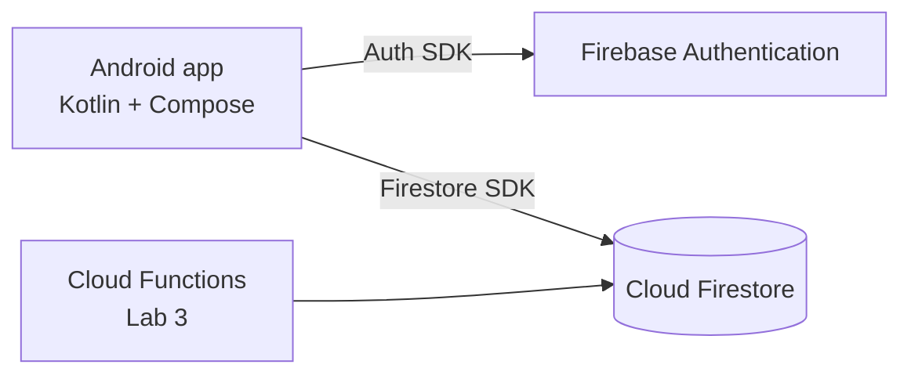

# Back2U

Students waste time asking around campus for lost items because there is no single place to see what has been lost or found.

## Team

One-person team, so all roles are held by one person.

| Name | Roles |
|---|---|
| Hzkiyas Kebede (Hzk-bk) | Product Owner, Tech Lead, Developer, QA/DevOps |

## MVP features

| # | Feature | Sprint |
|---|---|---|
| 1 | Register and log in with email and password | Sprint 1 |
| 2 | Browse the list of lost and found items | Sprint 1 |
| 3 | Post a lost or found item | Sprint 1 |
| 4 | Open item details | Sprint 1 |
| 5 | Edit or delete my own post | Later |
| 6 | Mark an item as returned | Later |

## Data model

### Collection `categories` (read-only reference data)

| Field | Type | Set by | Notes |
|---|---|---|---|
| name | string | Admin (Firebase console) | Display name, for example "Keys" |
| sortOrder | number | Admin (Firebase console) | Order of categories in the picker |

The document ID is the category ID (for example `keys`).

### Collection `items`

| Field | Type | Set by | Notes |
|---|---|---|---|
| ownerId | string | App | UID of the logged-in user |
| title | string | User | Required, 3 to 60 characters |
| description | string | User | Optional, up to 300 characters |
| type | string | User | "lost" or "found" |
| categoryId | string | User | Picked from `categories` |
| categoryName | string | App | Copied from the chosen category |
| location | string | User | Free text, required for "found" items |
| dateOccurred | timestamp | User | When it was lost or found, not in the future |
| status | string | App | "open" by default, "returned" (set by the user in E5) |
| createdAt | timestamp | Server | Server timestamp when created |
| updatedAt | timestamp | Server | Server timestamp on every edit |
Each item points to one category through `categoryId`, which is the document ID in `categories`.

## Architecture

The app uses three layers for authentication: a repository that talks to Firebase (`data`), validation and a ViewModel (`domain`, `ui/auth`), and Compose screens with navigation (`ui`).

## Tech stack

| Area | Technology |
|---|---|
| Language | Kotlin |
| UI | Jetpack Compose |
| Navigation | Navigation Compose |
| Authentication | Firebase Authentication (email and password) |
| Database | Cloud Firestore (location eur3, Europe) |
| Architecture | MVVM with a repository layer |
| Async | Kotlin coroutines and Flow |
| Build | Gradle (Kotlin DSL, version catalog), minSdk 26 |

## How to run

1. Clone the repository and open it in Android Studio (latest stable version).
2. Make sure the Android SDK platform 37 is installed (Tools → SDK Manager).
3. Create an emulator with Google Play services, or connect a phone with USB debugging.
4. Press Run. The `google-services.json` file for the Firebase project is included in `app/`.

## Definition of Done

A story is done when it is merged to main through a reviewed PR, works on the emulator with two different accounts, does not crash on invalid input and its issue is closed. This is a one-person team, so the review is a self-review comment on the PR.

