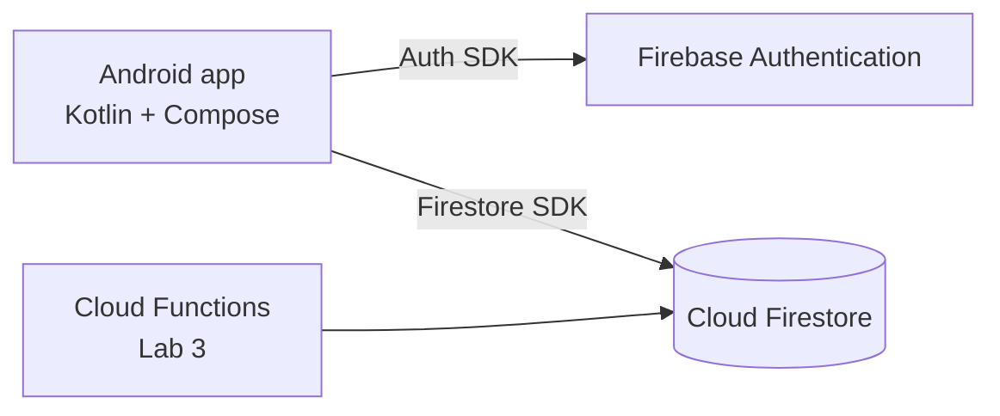

# Back2U

Students waste time asking around campus for lost items because there is no single place to see what has been lost or found.

## Team

One-person team, so all roles are held by one person.

| Name | Roles |
|---|---|
| Hzkiyas Kebede (Hzk-bk) | Product Owner, Tech Lead, Developer, QA/DevOps |

## MVP features

| # | Feature | Sprint |
|---|---|---|
| 1 | Register and log in with email and password | Sprint 1 |
| 2 | Browse the list of lost and found items | Sprint 1 |
| 3 | Post a lost or found item | Sprint 1 |
| 4 | Open item details | Sprint 1 |
| 5 | Edit or delete my own post | Later |
| 6 | Mark an item as returned | Later |

## Data model

**users**

| Field | Type |
|---|---|
| uid (document id) | string |
| email | string |
| displayName | string |
| createdAt | timestamp |

**items**

| Field | Type |
|---|---|
| ownerId (links to users.uid) | string |
| title | string |
| description | string |
| type ("lost" or "found") | string |
| location | string |
| status ("open" or "returned") | string |
| createdAt | timestamp |

## Architecture

The app uses three layers for authentication: a repository that talks to Firebase (`data`), validation and a ViewModel (`domain`, `ui/auth`), and Compose screens with navigation (`ui`).

## How to run

1. Clone the repository and open it in Android Studio (latest stable version).
2. Make sure the Android SDK platform 37 is installed (Tools → SDK Manager).
3. Create an emulator with Google Play services, or connect a phone with USB debugging.
4. Press Run. The `google-services.json` file for the Firebase project is included in `app/`.